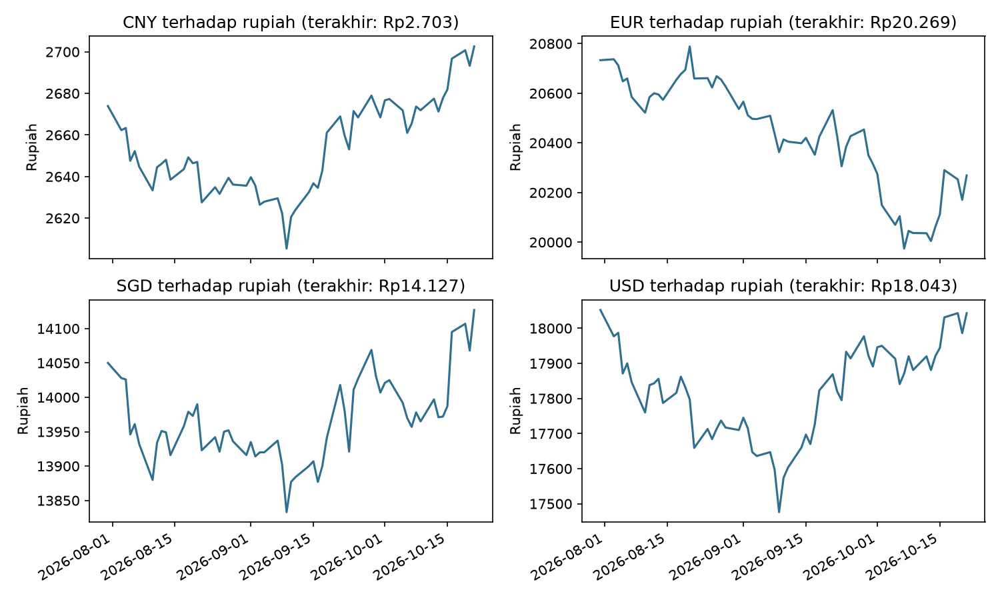

# Pemantau Kurs Rupiah Otomatis

Program Python yang mengambil kurs USD, EUR, SGD, dan CNY terhadap rupiah dari API publik,
menyimpannya ke CSV (hanya menambah data baru, tanpa duplikat), lalu membuat ringkasan,
grafik tren, dan laporan Excel. Bisa dijadwalkan agar berjalan sendiri setiap hari di Windows.



## Sumber data

[Frankfurter API](https://frankfurter.dev): gratis, tanpa kunci API. Kurs bersifat informasi
dan bukan nasihat keuangan.

## Cara kerja

1. `src/sumber.py` mengambil kurs per mata uang untuk rentang tanggal tertentu.
2. `src/perbarui.py` membaca `data/kurs_harian.csv`, mengambil data mulai dari tanggal terakhir yang
   tersimpan, menggabungkannya, membuang duplikat, lalu menyimpan lagi.
3. `src/laporan.py` membuat ringkasan (awal, terakhir, tertinggi, terendah, rata-rata, perubahan
   persen), grafik `output/tren_kurs.png`, dan `output/laporan_kurs.xlsx`.

Menjalankan `perbarui.py` berulang kali aman: baris yang sudah ada tidak pernah digandakan.

## Cara menjalankan

```bash
python -m venv .venv
.venv\Scripts\activate          # Windows
pip install -r requirements.txt
python src/perbarui.py
python src/laporan.py
```

## Menjalankan otomatis tiap hari (Windows)

`jalankan_harian.bat` menjalankan kedua skrip dan mencatat hasilnya ke `log.txt`. Daftarkan file itu
di Windows Task Scheduler dengan pemicu harian pukul 08:00 (kurs hari sebelumnya sudah terbit).

## Keterbatasan

- Berjalan hanya saat komputer menyala (ada pengaturan agar jalan sesudah terlewat).
- Belum diuji untuk jeda yang sangat panjang tanpa pembaruan (beberapa bulan).
- Kurs di akhir pekan dan hari libur tidak ada; grafik hanya memuat hari kerja.

## Lisensi

MIT. Lihat berkas `License`.